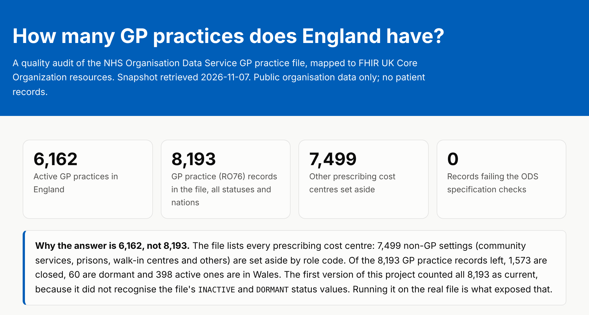
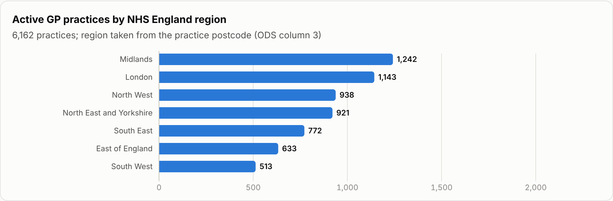
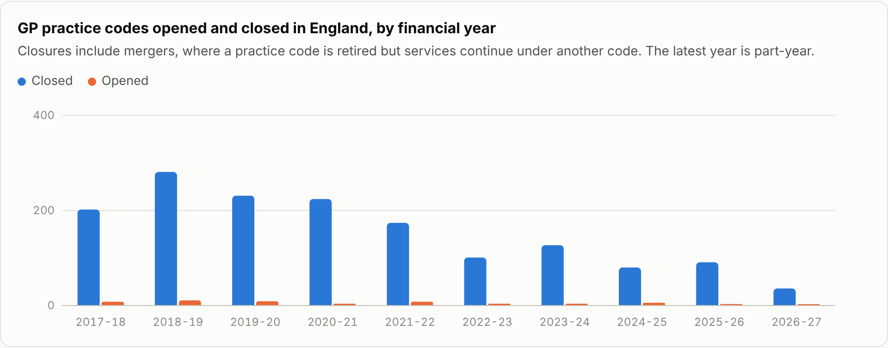
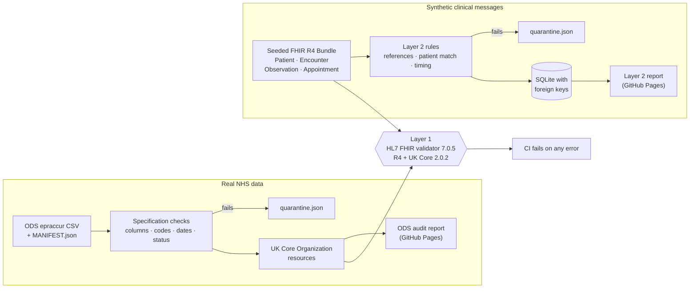

<div align="center">

# NHS FHIR Quality Gateway

**Does NHS data conform to the standard, and is it right? Two-layer validation for FHIR, proven on every GP practice in England.**

[](https://github.com/gbadedata/nhs-fhir-quality-gateway/actions/workflows/ci.yml)
[](https://gbadedata.github.io/nhs-fhir-quality-gateway/)


[](LICENSE)

[**Live report**](https://gbadedata.github.io/nhs-fhir-quality-gateway/) · [Two-layer validation](docs/two_layer_validation.md) · [ODS notes](docs/ods_directory.md) · [Safety boundary](docs/safety_case.md) · [Changelog](CHANGELOG.md)

</div>

<p align="center">
  <a href="https://gbadedata.github.io/nhs-fhir-quality-gateway/">
    <picture>
      <source media="(prefers-color-scheme: dark)" srcset="docs/images/hero-dark.png">
      
    </picture>
  </a>
</p>

## The short version

Interoperability needs two things: data that **conforms** to the standard, and data that is **right**. This project checks both, on real NHS organisation data and on synthetic clinical messages.

| Measure | Result |
|---|---|
| Active GP practices in England, from the NHS Organisation Data Service file of 7 Nov 2026 | **6,162** |
| UK Core Organization resources built from them: errors / warnings from the official HL7 validator | **0 / 0** |
| What the first version of this project reported, before it was run on real data | 8,193 |
| HL7 validator errors in the first version's synthetic messages, which its own checks passed at 100% | 270, now **0** |
| Planted defects caught: HL7 validator / this gateway's own rules | 1 of 4 / **4 of 4** |

## Contents

[Two layers](#two-layers-of-validation) · [What the real data showed](#what-the-real-data-showed) · [How it works](#how-it-works) · [Quickstart](#quickstart) · [UK Core mapping](#uk-core-mapping) · [Why the results hold up](#why-the-results-hold-up) · [Data and standards](#data-and-standards) · [Repository layout](#repository-layout) · [Limits](#limits-and-clinical-safety) · [Roadmap](#roadmap) · [Citation and licence](#citation-and-licence)

## Two layers of validation

| Layer | Tool | Question it answers |
|---|---|---|
| **1. Conformance** | Official HL7 FHIR validator 7.0.5, FHIR R4, UK Core 2.0.2 | Is every resource valid against the specification and the profile it claims? |
| **2. Business rules** | [`fhir_gateway/validate.py`](fhir_gateway/validate.py) | Do the resources make sense together, in ways a clinician would care about? |

Neither layer is enough on its own. The deliberately broken file [`fixtures/invalid_bundle.json`](fixtures/invalid_bundle.json) carries four known defects:

| Defect | HL7 validator | Gateway rules |
|---|:---:|:---:|
| Duplicate Patient entry | ✅ `bdl-7` | ✅ `duplicate_resource_id` |
| Observation pointing at an Encounter that does not exist | ❌ | ✅ `unresolved_encounter_reference` |
| Patient 2's Observation linked to patient 3's Encounter | ❌ | ✅ `encounter_patient_mismatch` |
| Observation timed a day before its Encounter began | ❌ | ✅ `observation_outside_encounter_period` |

The reverse also happened. The first version relied on its own rules alone and described its output as "FHIR R4-shaped". Its synthetic Bundle passed those rules at 100%. The HL7 validator then found 270 errors in the same file:
- an `example.org` identifier system;
- a missing vital-signs category on every body-temperature Observation, which FHIR R4's body temperature profile requires;
- fullUrls that relative references could not resolve against.

All are fixed, and CI now fails if conformance regresses. Details: [`docs/two_layer_validation.md`](docs/two_layer_validation.md).

## What the real data showed

The NHS Organisation Data Service file `epraccur` lists every prescribing cost centre: 15,692 rows. Getting from there to "GP practices in England" takes three filters, each one a place to go wrong. The other settings are community services, prisons, walk-in centres and similar:

```text
15,692 prescribing cost centres
 └─ 8,193  GP practices (role RO76); 7,499 other settings set aside
     └─ 6,560  ACTIVE; 1,573 INACTIVE and 60 DORMANT removed
         └─ 6,162  in England; 398 active Welsh practices removed
```

The first version of this project reported all 8,193 as current. It had only been tested on invented rows and did not recognise the file's `INACTIVE` and `DORMANT` status values. Running it on the real file exposed the error, and the parser was rebuilt from the [ODS field specification](https://www.odsdatasearchandexport.nhs.uk/referenceDataCatalogue/565791179.html).

<picture>
  <source media="(prefers-color-scheme: dark)" srcset="docs/images/regions-dark.png">
  
</picture>

<picture>
  <source media="(prefers-color-scheme: dark)" srcset="docs/images/closures-dark.png">
  
</picture>

Since April 2017, 1,547 English GP practice codes have closed and 57 have opened. A closed code often reflects a merger, with services continuing under another code, so this measures consolidation rather than lost access. ODS notes that closures before April 2017 are incomplete in this file.

## How it works



## Quickstart

Python 3.11 or later; nothing to install. The conformance step also needs Java 17 or later and internet access for its first run.

```bash
git clone https://github.com/gbadedata/nhs-fhir-quality-gateway.git
cd nhs-fhir-quality-gateway

python -m ods_directory                  # audit the committed ODS snapshot
python -m unittest discover -s tests     # 60 tests
python -m fhir_gateway run --input fixtures/invalid_bundle.json --output build/invalid
conformance/run_validator.sh             # layer 1: HL7 validator (needs Java 17+)
```

Expected output of the first command:

```text
6,162 active GP practices in England (8,193 GP practice records in file). Report: reports/ods/index.html
```

`build/invalid/quarantine.json` then lists the four planted defects with their reason codes. `python -m ods_directory --download` fetches this week's file from ODS instead of the committed snapshot.

## UK Core mapping

| ODS `epraccur` | UK Core Organization |
|---|---|
| Organisation code | `id`; `identifier` with system `https://fhir.nhs.uk/Id/ods-organization-code` |
| Status | `active`: true only for `ACTIVE` |
| Open and close dates | `organization-period` extension |
| Name, address lines, town, postcode | `name`, `address` |
| Prescribing telephone | `telecom` |
| Commissioner (Sub ICB Location) | `partOf`, as a logical reference by ODS code |
| GP practice | `type` `prov` (HL7 organization-type, the UK Core binding) |

<details>
<summary>An example resource, exactly as generated</summary>

```json
{
  "resourceType": "Organization",
  "id": "A81001",
  "meta": { "profile": ["https://fhir.hl7.org.uk/StructureDefinition/UKCore-Organization"] },
  "text": {
    "status": "generated",
    "div": "<div xmlns=\"http://www.w3.org/1999/xhtml\">THE DENSHAM SURGERY (A81001), GP practice, ODS status ACTIVE, TS18 1HU</div>"
  },
  "extension": [
    { "url": "http://hl7.org/fhir/StructureDefinition/organization-period", "valuePeriod": { "start": "1974-04-01" } }
  ],
  "identifier": [{ "system": "https://fhir.nhs.uk/Id/ods-organization-code", "value": "A81001" }],
  "active": true,
  "type": [{ "coding": [{ "system": "http://terminology.hl7.org/CodeSystem/organization-type", "code": "prov", "display": "Healthcare Provider" }] }],
  "name": "THE DENSHAM SURGERY",
  "address": [{ "use": "work", "line": ["HEALTH CENTRE", "LAWSON STREET"], "city": "STOCKTON-ON-TEES", "postalCode": "TS18 1HU", "country": "GB" }],
  "telecom": [{ "system": "phone", "value": "01642 672351", "use": "work" }],
  "partOf": {
    "identifier": { "system": "https://fhir.nhs.uk/Id/ods-organization-code", "value": "16C" },
    "display": "Commissioning Sub ICB Location (ODS RE4 relationship)"
  }
}
```

</details>

## Why the results hold up

| Check | What it guarantees | Where |
|---|---|---|
| ODS snapshot committed with SHA-256, size and retrieval date | The audited file is exactly what ODS published on 7 Nov 2026 | [`data/ods/MANIFEST.json`](data/ods/MANIFEST.json) |
| Real-file counts pinned as tests (15,692 · 8,193 · 6,162) | A parser change that alters the answer fails the build | [`tests/test_ods_directory.py`](tests/test_ods_directory.py) |
| Parser built from the ODS specification, legacy encodings included | Works on current and older `epraccur` files | [`ods_directory/epraccur.py`](ods_directory/epraccur.py) |
| Pinned HL7 validator (7.0.5) and UK Core package (2.0.2) | Conformance results are reproducible | [`conformance/run_validator.sh`](conformance/run_validator.sh) |
| CI fails if validator output is missing, any real bundle has an error, or the broken fixture passes | A green tick means the validator really ran and really checked | [`conformance/summarise.py`](conformance/summarise.py) |
| Regression tests for every fix the validator forced | The 270 errors cannot quietly return | [`tests/test_gateway.py`](tests/test_gateway.py) |

60 tests, run on Python 3.11, 3.12 and 3.13.

## Data and standards

| Component | Version | Source |
|---|---|---|
| ODS `epraccur` (prescribing cost centres) | Snapshot of 7 Nov 2026; refreshed weekly | [NHS England ODS](https://digital.nhs.uk/services/organisation-data-service/data-search-and-export/csv-downloads/gp-and-gp-practice-related-data) |
| HL7 FHIR | R4 (4.0.1) | [hl7.org/fhir/R4](https://hl7.org/fhir/R4/) |
| UK Core | `fhir.r4.ukcore.stu2` 2.0.2 | [Simplifier package registry](https://simplifier.net/packages/fhir.r4.ukcore.stu2) |
| HL7 FHIR validator | `validator_cli.jar` 7.0.5 | [hapifhir/org.hl7.fhir.core](https://github.com/hapifhir/org.hl7.fhir.core/releases/tag/7.0.5) |

## Repository layout

```text
nhs-fhir-quality-gateway/
├── ods_directory/          real data: ODS parser, quality summary, UK Core mapping, report
├── fhir_gateway/           synthetic FHIR R4 generator, layer 2 rules, SQLite load, report
├── conformance/            HL7 validator runner and result summaries
├── data/ods/               ODS snapshot + MANIFEST.json
├── fixtures/               valid and deliberately invalid Bundles (scripts/make_fixtures.py rebuilds them)
├── reports/                ods/ (real data) and synthetic/ (layer 2) reports
├── tests/                  60 tests
└── docs/                   decisions, two-layer validation, ODS notes, data contract, safety boundary
```

## Limits and clinical safety

- The validator runs without a terminology server, so membership of code systems (for example UCUM `Cel`) is reported as unchecked. Set `FHIR_TX` to point it at one.
- UK Core conformance is claimed only for the ODS Organization resources. The synthetic clinical resources conform to base FHIR R4 and carry no NHS Number by design.
- Passing both layers means data is well formed and internally consistent. It is not evidence of clinical correctness and not clinical safety assurance: any real deployment would need DCB0129 and DCB0160 clinical risk management and a Clinical Safety Officer. See [`docs/safety_case.md`](docs/safety_case.md).
- Independent work, not affiliated with or endorsed by NHS England.

## Roadmap

- [ ] Run the validator against a terminology server in CI, so code-system membership is checked too
- [ ] Map ODS role codes into an extension alongside the UK Core organisation type
- [ ] Validate a UK Core Patient and Encounter profile path with synthetic NHS Numbers that pass the check-digit rule
- [ ] Publish the full UK Core Bundle as a downloadable release asset

## Citation and licence

To cite this project, use the metadata in [`CITATION.cff`](CITATION.cff) (GitHub's "Cite this repository" button reads it).

Code: [MIT](LICENSE). ODS data: contains public sector information licensed under the [Open Government Licence v3.0](https://www.nationalarchives.gov.uk/doc/open-government-licence/version/3/).

Built by [Oluwagbade Odimayo](https://gbadedata.com). Questions and corrections are welcome as [issues](https://github.com/gbadedata/nhs-fhir-quality-gateway/issues).
