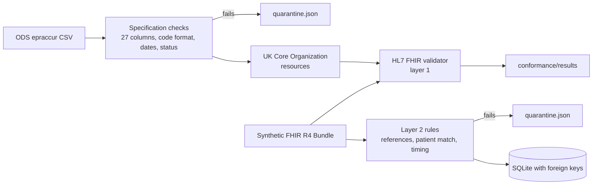

# NHS FHIR Quality Gateway

[](https://github.com/gbadedata/nhs-fhir-quality-gateway/actions/workflows/ci.yml)
  

Two questions every NHS interoperability project has to answer before data moves between systems: **does it conform to the standard**, and **is it right?** This project answers both, on real NHS organisation data and on synthetic clinical messages.

- **Layer 1, conformance:** the official HL7 FHIR validator checks every resource against FHIR R4, and the GP practice resources against the UK Core Organization profile.
- **Layer 2, business rules:** checks the standard cannot express, such as a temperature reading linked to another patient's encounter, or timed before the visit began.

## Results

**Real data: every GP practice in England.** The NHS Organisation Data Service file (`epraccur`, 15,692 rows, retrieved 7 November 2026) was audited against its published specification and mapped to UK Core Organization resources.

| | Count |
|---|---|
| Prescribing cost centres in the file | 15,692 |
| GP practice records (role RO76), all statuses and nations | 8,193 |
| Active GP practices in England | **6,162** |
| Rows failing the specification checks | 0 |
| UK Core Organization resources: HL7 validator errors / warnings | **0 / 0** |

The first version of this project reported 8,193 "valid GP practices". It had been tested only on invented rows, and did not recognise the file's `INACTIVE` and `DORMANT` status values, so 1,633 closed or dormant practices and 398 Welsh practices were counted as current. Running it on the real file is what exposed this. Since April 2017, 1,547 English practice codes have closed and 57 have opened. A closed code often reflects a merger, with services continuing under another code, so this measures consolidation rather than lost access.

**Synthetic clinical messages.** The first version's own validator accepted 100% of its synthetic Bundle. The HL7 validator found **270 errors** in the same file: an `example.org` identifier system, a missing vital-signs category on every body-temperature Observation, and fullUrls that broke reference resolution. All are fixed; the Bundle now has 0 errors.

**Why two layers.** The deliberately broken fixture has four defects. The HL7 validator catches one. The gateway's own rules catch all four:

| Defect in `fixtures/invalid_bundle.json` | HL7 validator | Gateway rules |
|---|---|---|
| Duplicate Patient entry | error (bdl-7) | `duplicate_resource_id` |
| Observation pointing at an Encounter that does not exist | not flagged | `unresolved_encounter_reference` |
| Patient 2's Observation linked to patient 3's Encounter | not flagged | `encounter_patient_mismatch` |
| Observation timed a day before its Encounter | not flagged | `observation_outside_encounter_period` |

Reports: [`reports/ods/index.html`](reports/ods/index.html) (real ODS audit) and [`reports/synthetic/index.html`](reports/synthetic/index.html) (layer 2 on synthetic messages).

## Run it

Python 3.11+, standard library only. The conformance step also needs Java 17+.

```bash
python -m ods_directory                       # audit the committed ODS snapshot, write reports/ods/
python -m ods_directory --download            # or fetch this week's file from ODS
python -m fhir_gateway run --output build     # synthetic clinical Bundle through layer 2
python -m unittest discover -s tests -v       # 56 tests
conformance/run_validator.sh                  # layer 1: official HL7 validator, pinned UK Core 2.0.2
```

## How it fits together



## Repository map

| Path | What it is |
|---|---|
| `ods_directory/` | ODS parser built from the Reference Data Catalogue field mapping, quality summary, UK Core mapping, report |
| `fhir_gateway/` | Synthetic FHIR R4 generator and layer 2 cross-resource rules, SQLite load, quality report |
| `conformance/` | Script that runs the HL7 validator, and the committed summaries of its results |
| `data/ods/` | The ODS snapshot used, with `MANIFEST.json` (URL, date, size, SHA-256) |
| `fixtures/` | Valid and deliberately invalid synthetic Bundles; rebuilt by `scripts/make_fixtures.py` |
| `docs/` | Decision log, ODS notes, two-layer validation, data contract, safety boundary |

## Limits

- The validator ran without a terminology server (`-tx n/a`), so code-system membership (for example UCUM `Cel`) is reported as unchecked. CI can point `FHIR_TX` at a terminology server.
- UK Core conformance is claimed only for the ODS Organization resources. The synthetic clinical resources conform to base FHIR R4; they deliberately carry no NHS Number and do not claim UK Core Patient.
- Passing both layers says the data is well formed and internally consistent. It says nothing about clinical correctness and is not clinical safety assurance (DCB0129 and DCB0160 would apply to any real deployment). See `docs/safety_case.md`.
- ODS publishes `epraccur` weekly. Counts are for the 7 November 2026 snapshot.
- Independent portfolio work. Not affiliated with or endorsed by NHS England.

## Sources

- NHS England ODS, [GP and GP practice related data](https://digital.nhs.uk/services/organisation-data-service/data-search-and-export/csv-downloads/gp-and-gp-practice-related-data) and the [Reference Data Catalogue entry for epraccur](https://www.odsdatasearchandexport.nhs.uk/referenceDataCatalogue/565791179.html).
- HL7 UK, UK Core `fhir.r4.ukcore.stu2` 2.0.2 (Simplifier package registry).
- HL7, [FHIR Validator](https://github.com/hapifhir/org.hl7.fhir.core) (`validator_cli.jar`).
- NHS England, [Clinical risk management standards](https://digital.nhs.uk/services/clinical-safety/clinical-risk-management-standards).

ODS data re-used under the Open Government Licence v3.0. Code: MIT.
